# CampusAI main 分支运行与功能检查方案

编制日期：2026-11-24。已核对的主仓库：`E:\School Study\Software_Engineering\期末大作业\CampusAI`；当前分支 `main`，本地与已记录的 `origin/main` 均为 `10099b1`，包括 PR2、PR3、权限脚本修复和前端会话修复。

这是一份基于当前代码核对的执行方案。本轮没有运行合并后的整套测试或真实模型请求；下文“预期”不是已完成的验收结果。请按实际结果填写记录。

## 先明确本次验收范围

| 模块 | 当前实现 | 本次检查方式 |
| --- | --- | --- |
| 登录、身份、角色、课程范围、退出 | 真实后端接口 | 自动脚本、管理后台和 RAG 页面 |
| 管理后台七个页面 | 页面框架；身份与课程信息真实 | 页面导航、角色入口、课程详情、会话恢复 |
| 管理后台资料、题库、问答、统计、用户管理 | 仍使用模拟数据或模拟操作 | 只验页面能显示，不验真实保存和真实统计 |
| RAG 独立演示页 | 真实上传、解析、发布、检索、来源、模型问答、下架、替换、删除 | 本次业务验收的主要入口 |
| 学生小程序/H5 | 登录、我的课程和课程详情基础工程 | 作为补充检查；尚未接上完整 RAG 业务页面 |
| 问答历史、真实反馈、完整题库和学习统计 | 本次合并没有完成正式业务联调 | 不标记为已完成 |

两个 PR 合并不会自动让管理后台的 `src/api/content.js` 模拟接口变成真实 RAG 接口。真实资料和问答请使用 `rag-demo.html`。

## 统一使用的目录、端口与账号

为了避免继续访问旧 PR2 服务，本方案为 main 单独使用以下端口：

| 用途 | 地址或目录 |
| --- | --- |
| main 后端 / RAG 页面 | `http://127.0.0.1:18082/rag-demo.html` |
| main 管理后台 | `http://127.0.0.1:5175` |
| 学生 H5（补充项） | `http://127.0.0.1:5174`，来自现有配置 |
| main 文件数据库 | `CampusAI\backend\data\rag-demo` 对应的 H2 文件 |
| 后端运行日志 | `CampusAI\backend\target\rag-demo.log`、`rag-demo.stderr.log`、`rag-demo.stdout.log` |

`CampusAI-pr2` 的数据库与 main 的数据库属于不同目录。main 首次运行看不到 PR2 上传过的资料是正常现象；按本方案重新导入样例即可。同一 Windows 用户之前保存的模型配置可由 main 的启动脚本自动读取，无需再次复制密钥。

| 账号 | 角色 | 预期课程范围 |
| --- | --- | --- |
| admin | 管理员 | CS101 计算机导论、SE101 软件工程 |
| teacher | 教师 | CS101、SE101；当前两门都由该教师负责 |
| student | 学生 | 仅 CS101 |
| student2 | 学生 | 仅 SE101 |

以下按本地普通演示模式和统一默认密码 `CampusAI-Dev-2026` 编写，不使用 `-PublicAccess`。若你已经设置统一密码，应在启动环境、验证参数和页面登录中使用相同值。若设置了四个账号各自的密码，现有 `verify-api.ps1` / `verify-rag.ps1` 的单一 `-DemoPassword` 参数不能直接验证不同密码的四个账号，应使用普通本地演示配置或逐账号手工检查。

## 准备步骤：确认 main、环境和端口

1. 打开 PowerShell 7.4 或更新版本。启动脚本使用 `Start-Process -Environment`，仅有 PowerShell 7.0 还不够。
2. 进入主仓库并核对状态：

```powershell
Set-Location 'E:\School Study\Software_Engineering\期末大作业\CampusAI'
git status --short --branch
git branch --show-current
git log -3 --oneline
```

预期当前分支为 main，当前核对版本的顶端提交为 `10099b1`。后续 main 有新提交时，以实际记录的 SHA 为准。不要在 `CampusAI-pr2` 或 `CampusAI-pr3` 目录执行本方案。

3. 工作区无待处理修改时，可同步远端：

```powershell
git pull --ff-only origin main
```

4. 检查环境和计划使用的端口：

```powershell
$PSVersionTable.PSVersion
java -version
node --version
npm.cmd --version
Get-NetTCPConnection -State Listen -LocalPort 18082,5175 -ErrorAction SilentlyContinue
```

要求 Java 17 或 21、Node.js 至少 22.12.0。Maven 使用仓库自带 Wrapper，首次运行可能需要下载。端口检查无输出表示当前没有监听者。如果端口被占用，先确认是哪个服务；不要直接结束未知进程。

## 方案 1：自动测试与构建

目的：确认合并后的源码、依赖和回归测试能通过。

步骤 1：在 main 根目录运行后端测试和打包。

```powershell
Set-Location 'E:\School Study\Software_Engineering\期末大作业\CampusAI'
.\backend\mvnw.cmd -f .\backend\pom.xml verify
```

预期 `BUILD SUCCESS`，测试失败数和错误数均为 0，并生成 `backend/target/campusai-backend-0.1.0-SNAPSHOT.jar`。以本次终端结果为准，不把仓库里之前的“86 项通过”记录当作本次执行结果。

步骤 2：重新安装 main 的后台依赖，执行会话回归和生产构建。

```powershell
Set-Location 'E:\School Study\Software_Engineering\期末大作业\CampusAI\admin-web'
npm.cmd ci
npm.cmd test
npm.cmd run build
```

每一步成功后再执行下一步。PR3 目录安装过依赖，不代表 main 目录的依赖已更新。预期前端测试 `tests 13 / pass 13 / fail 0`，构建成功；现有大包体积提示不等于编译失败。

步骤 3：查看结果文件。

- 后端详细测试报告：`backend/target/surefire-reports/`。
- 固定 40 题检索报告：`backend/target/rag-evaluation-results.md` 与 JSON。
- 后台构建产物：`admin-web/dist/`。

固定检索报告用于观察已知题集的表现，不代表真实模型答案准确率。测试通过也不代表所有无依据问题都能正确拒答，应保留报告中的误召回记录。

通过标准：后端测试/打包通过，前端 13 项通过，前端构建通过。任一步失败先定位，不跳过测试继续宣称验收完成。

## 方案 2：启动 main，验证真实 HTTP 链路

目的：确认访问的是 main 新构建的后端，并跑通真实认证、上传、检索及资料权限接口。

步骤 1：方案 1 已打包成功后，在 PowerShell 终端 A 执行：

```powershell
Set-Location 'E:\School Study\Software_Engineering\期末大作业\CampusAI'
pwsh -NoProfile -File .\scripts\start-rag-demo.ps1 -Port 18082 -SkipBuild -Background
```

`-Background` 表示启动后返回终端；脚本仍会等待后端就绪。预期输出“后端已就绪”和 18082 的演示地址。不要只凭 `Tomcat initialized` 判断启动成功。

如果你跳过了方案 1 的打包，可去掉 `-SkipBuild`，脚本会先打包；该启动过程使用跳过测试的构建参数，不能替代方案 1 的测试验收。

步骤 2：确认页面和监听端口：

```powershell
Get-NetTCPConnection -State Listen -LocalPort 18082
(Invoke-WebRequest 'http://127.0.0.1:18082/rag-demo.html').StatusCode
```

预期监听端口存在，页面返回 200。页面 200 只代表入口可达，不等于模型可用。

步骤 3：运行现有 HTTP 检查：

```powershell
pwsh -NoProfile -File .\scripts\verify-api.ps1 -BaseUrl 'http://127.0.0.1:18082' -DemoPassword 'CampusAI-Dev-2026'
pwsh -NoProfile -File .\scripts\verify-rag.ps1 -BaseUrl 'http://127.0.0.1:18082' -DemoPassword 'CampusAI-Dev-2026'
```

预期认证脚本输出所有 PASS 和 `All CampusAI API checks passed.`；RAG 脚本输出上传/发布/检索/来源/权限、资料版本与引用失效、临时资料删除的 PASS。

RAG 脚本会创建自己的临时资料，并在 finally 中尝试清理；若出现清理警告，请根据输出的资料 ID 核对。它还会发起一次问答，已配置真实模型时可能触发一次真实模型调用。

关键判定：RAG 脚本接受 `generated`、`retrieval_only` 或 `no_evidence` 作为明确响应状态。因此脚本通过不能单独证明 DeepSeek 生成成功；真实模型能力须执行方案 5。

## 方案 3：管理后台登录、角色与课程页面

目的：验收 PR3 已真实接通的功能及七个页面的可访问性。

步骤 1：新开 PowerShell 终端 B，启动 main 前端：

```powershell
Set-Location 'E:\School Study\Software_Engineering\期末大作业\CampusAI\admin-web'
$env:CAMPUSAI_BACKEND_URL = 'http://127.0.0.1:18082'
npm.cmd run dev -- --port 5175 --strictPort
```

打开 `http://127.0.0.1:5175`，保持终端 B 运行。代理变量只对该终端启动的 Vite 生效，修改后要重启 Vite。

步骤 2：依次执行下表；切换账号前先退出。

| 操作步骤 | 预期结果 |
| --- | --- |
| 输入 admin 与错误密码 | 留在登录页，显示错误，不进入后台 |
| 用 admin 正确登录 | 进入工作台，显示管理员身份，侧栏包含“用户与角色” |
| 依次打开七个页面 | 页面可显示，无白屏或未捕获异常；模拟数据按原型展示 |
| 进入“课程与章节”并打开章节弹窗 | 真实课程为 CS101、SE101；课程名称、编号、简介正确；章节仍是示例 |
| 刷新页面 | 会话有效时恢复当前身份 |
| 退出并用 teacher 登录 | 教师身份；菜单没有“用户与角色” |
| teacher 直接访问 `http://127.0.0.1:5175/#/users` | 返回工作台并提示没有权限 |
| 退出后用 student 登录管理后台 | 提示仅对教师和管理员开放 |
| 未登录访问 `http://127.0.0.1:5175/#/overview` | 返回登录页 |

密码错误示例：
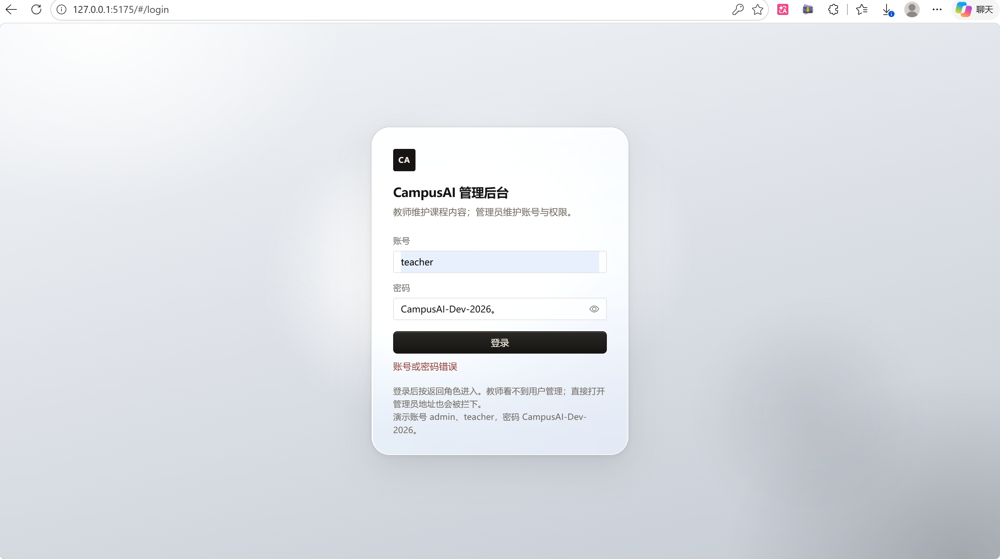
正确登录：
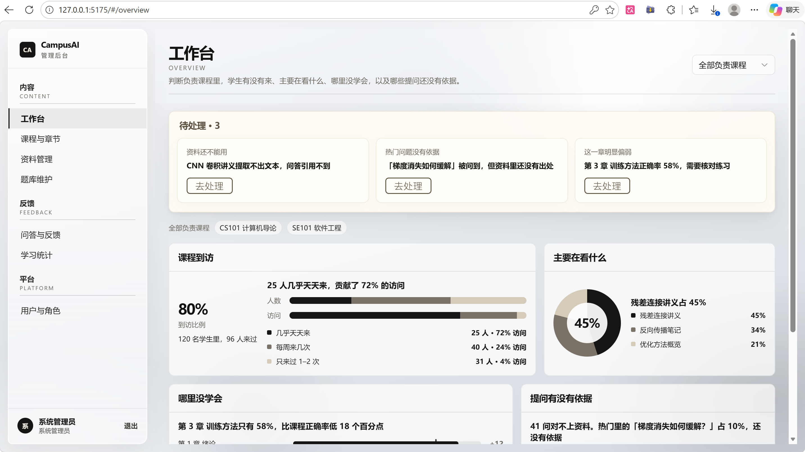
依次打开七个界面：
1.工作台
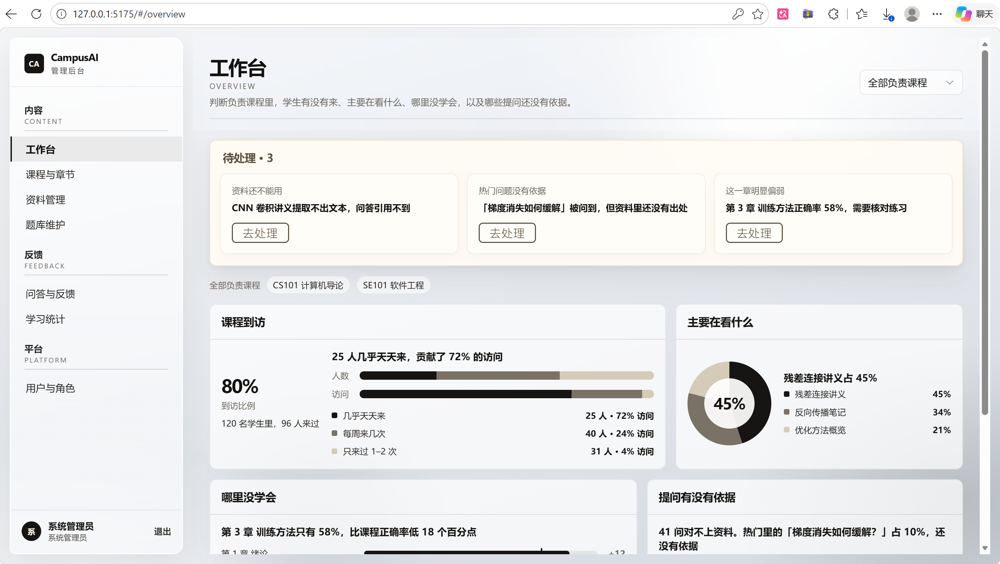
2.课程与章节
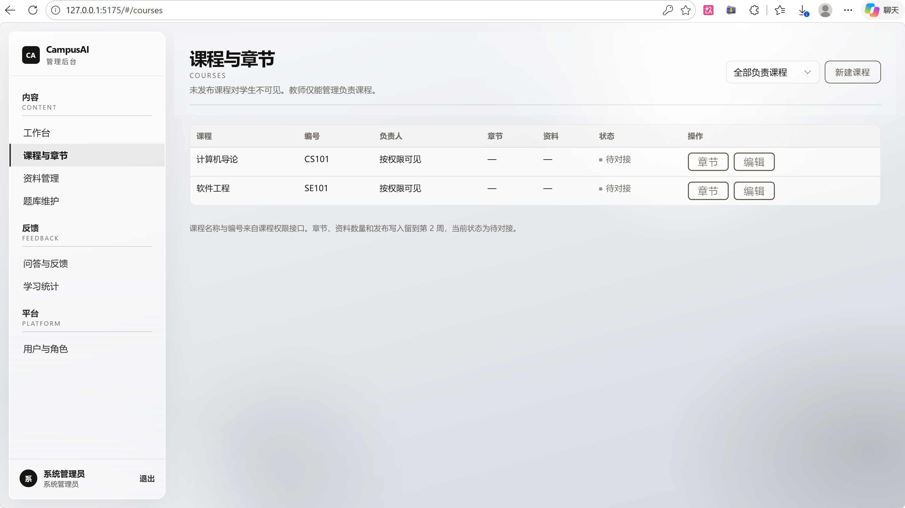
3.资料管理
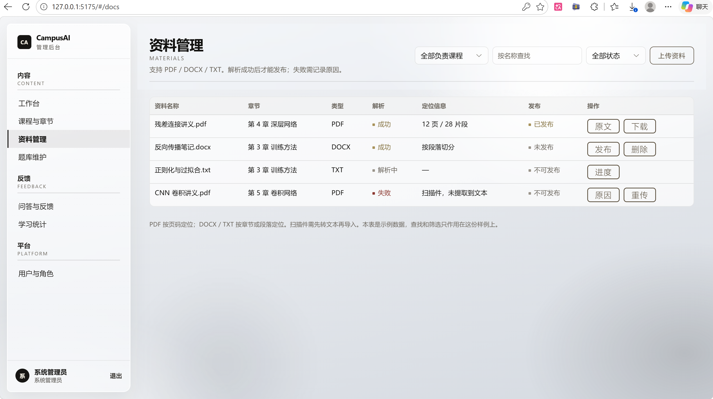
4.题库维护
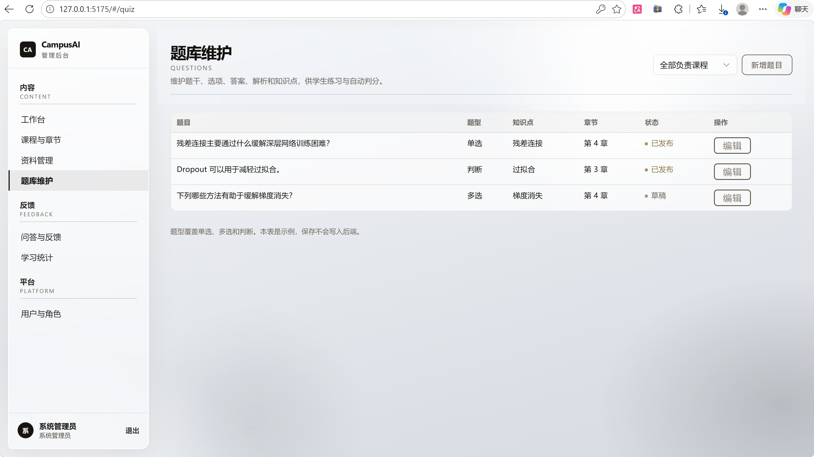
5.问答与维护
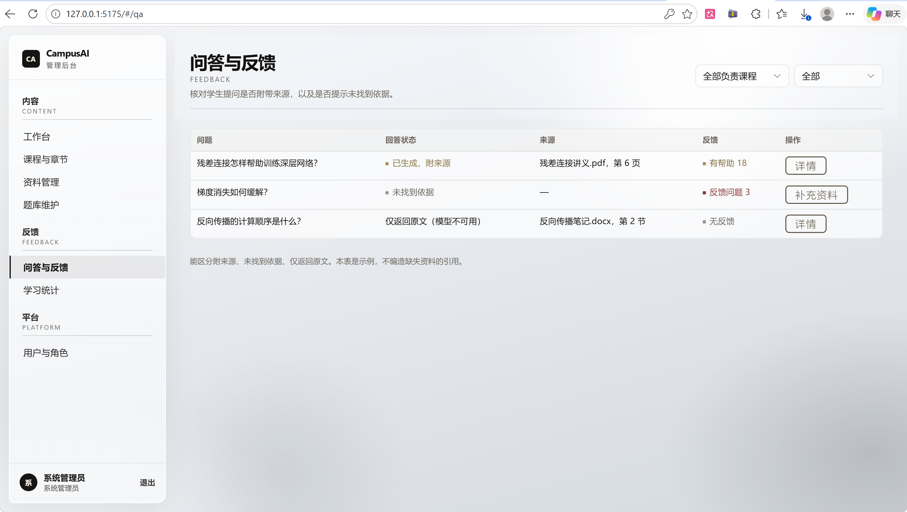
6.学习统计
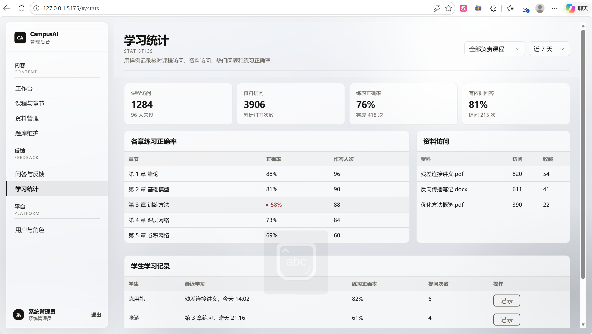
7.用户与角色
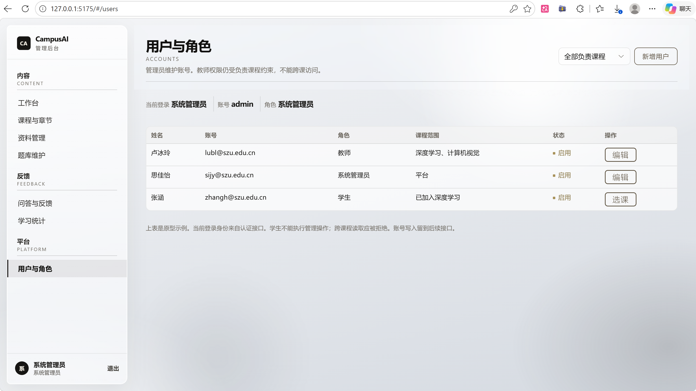
步骤 3：记录浏览器 Console 中的错误、失败请求路径与界面截图。模拟“上传成功”“保存成功”提示不能计入真实业务验收；也不要把模拟统计数字写入项目实际效果报告。

## 方案 4：三种资料格式的上传、发布、检索与来源

目的：检查真实解析与检索链路。使用 RAG 页面，不使用管理后台的模拟资料页。

步骤 1：打开 `http://127.0.0.1:18082/rag-demo.html`，用 teacher 登录，选择“计算机导论”。

步骤 2：从 main 的 `docs/rag/samples/` 分别上传：

- `parsing-demo.txt`
- `parsing-demo.docx`
- `parsing-demo.pdf`

每个文件都通过“上传并解析”提交。预期解析完成显示“待发布”，有非零片段数，版本为 v1；不应自动发布。当前解析是同步完成的，不要求一定看到持续的“处理中”队列。

步骤 3：先不发布，用另一个浏览器窗口/标签页以 student 登录，刷新资料列表。预期学生看不到这几份草稿。

步骤 4：回到 teacher 页面逐份点击“发布”，student 刷新资料后应能看到它们。

教师发布资料：
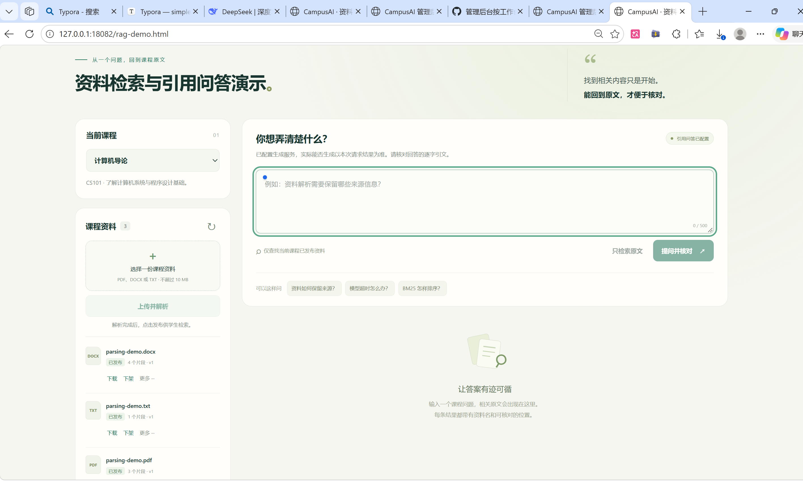
步骤 5：以 student 分别输入下列问题，点击“只检索原文”：

| 样例 | 查询示例 | 核对重点 |
| --- | --- | --- |
| TXT | 模型服务不可用时系统如何处理？ | 返回的原文有“返回检索原文与来源”；段落范围包含实际物理第 7 行 |
| DOCX | 模型超时时如何处理？ | “故障回退”内容；对应第 14–15 段，或覆盖它们的片段范围 |
| PDF | How does BM25 rank text? | 英文原文与实际 PDF 第 1 页相符 |

三份样例主题有重叠，不强制某一种格式必须排第一；要检查某一格式时，教师可暂时下架其他两份，测试后再恢复发布。
学生端提问问题

样例1：

样例2：
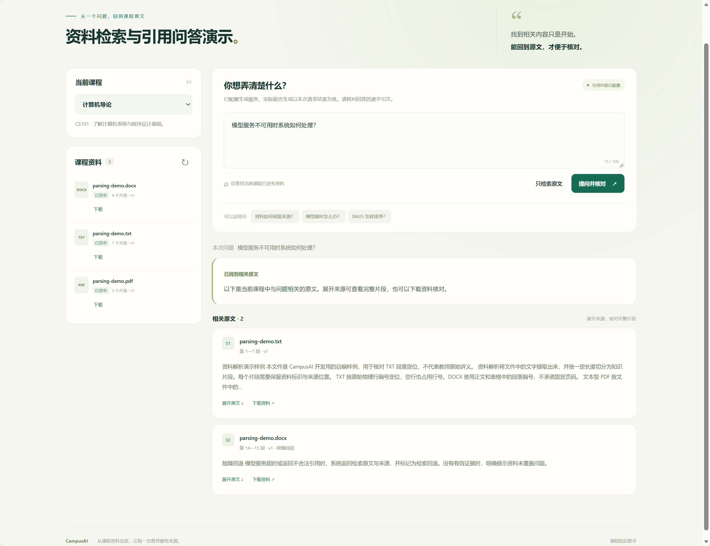
样例3：
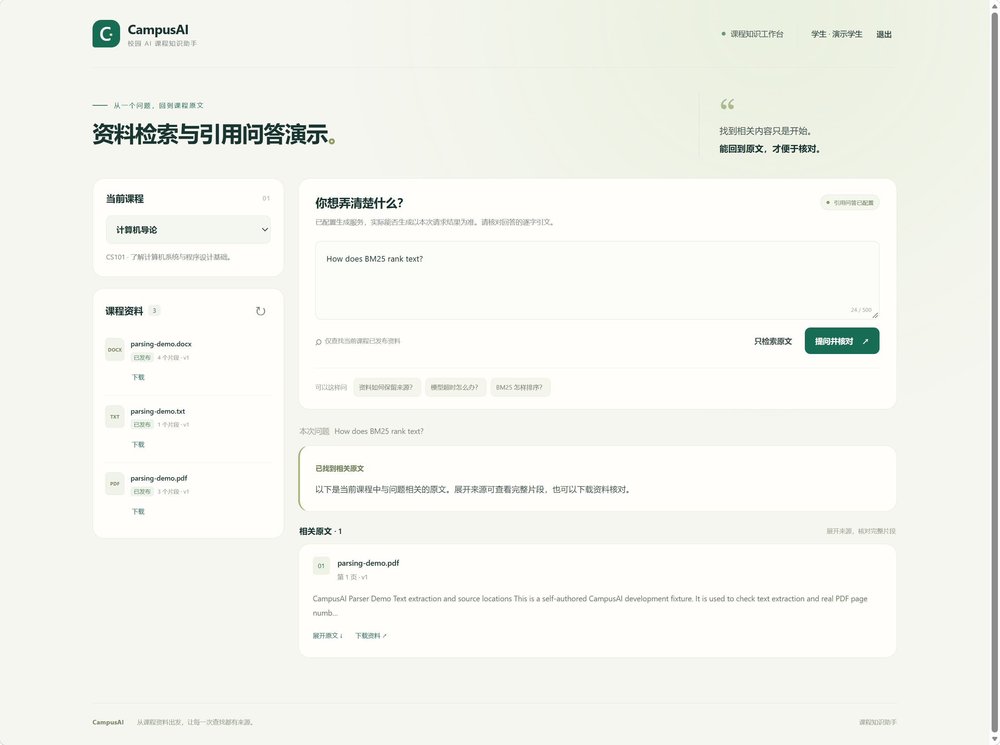
步骤 6：展开来源并下载原文件，核对文件名、原文内容与位置。只有 PDF 使用真实页码；TXT/DOCX 是段落范围。片段可能合并相邻段落，因此不要要求返回范围只能精确等于某一行。

步骤 7：补充一个无效文件检查：用一个空 TXT 或格式不符文件测试上传。预期页面明确拒绝，或资料进入 FAILED 并显示原因；不能变成已发布可检索资料。扫描 PDF 当前不支持 OCR，应如实失败。

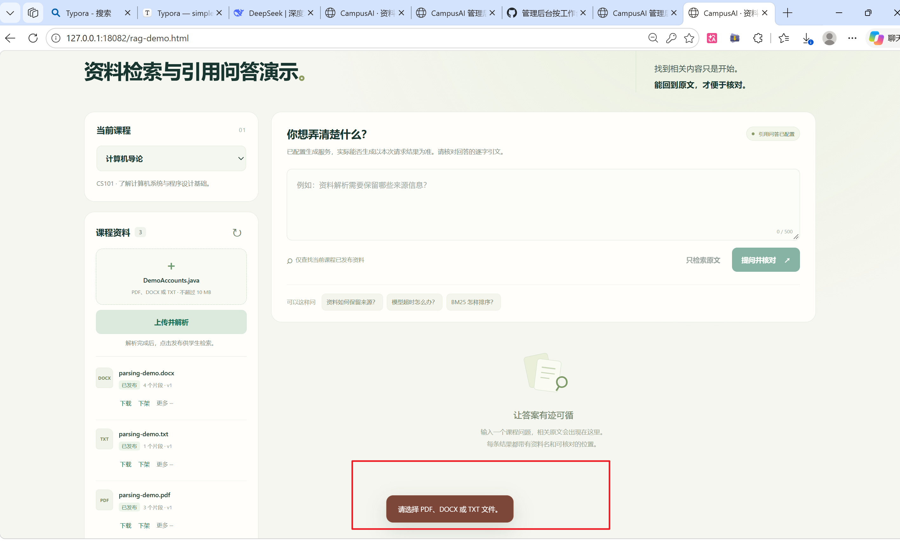

通过标准：三种有效格式均可解析/发布/检索/定位/下载，草稿对学生不可见，无效输入不伪装成功。

## 方案 5：DeepSeek 真实问答与无依据边界

目的：区分模型已配置、实际生成成功和检索回退，并人工核对回答依据。

步骤 1：teacher 在 RAG 页选择“软件工程”，上传并发布 `docs/rag/samples/course-2-evaluation.txt`。

步骤 2：用 student2 登录软件工程，观察模型配置提示。同一 Windows 用户之前保存的 DeepSeek 配置，会由 `start-rag-demo.ps1` 自动读取。提示“已配置”不保证服务健康。

如果提示未配置，且确实需要重新配置，可在 main 根目录执行：

```powershell
pwsh -NoProfile -File .\scripts\set-rag-model.ps1
pwsh -NoProfile -File .\scripts\stop-rag-demo.ps1 -Port 18082
pwsh -NoProfile -File .\scripts\start-rag-demo.ps1 -Port 18082 -SkipBuild -Background
```
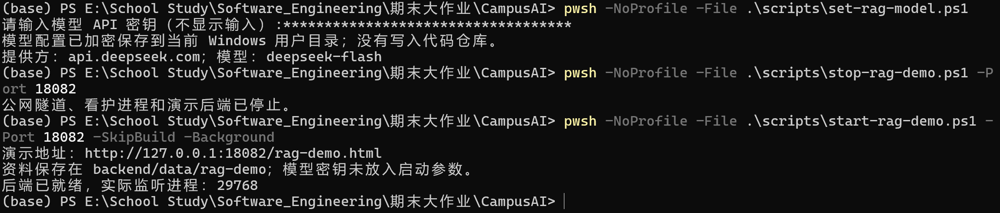
密钥在交互提示中输入。已经能读取原有配置时不需要重复执行。重启后重新登录。


步骤 3：输入“软件需求的验收标准应该怎样表达？”，先点击“只检索原文”，确认命中“可观察和核对的条件”等样例内容。

步骤 4：同一个问题点击“提问并核对”。在浏览器 Network 中检查 `/ask` 的响应：

| 返回状态 | 判定 |
| --- | --- |
| `generated`，且有可核对的 claims/citations | 生成链路成功，继续人工核对回答语义 |
| `retrieval_only` | 回退链路成功，但本次真实模型生成没有通过；记录 reason |
| `no_evidence` | 没有合格依据或模型认为候选不足；不能算生成成功 |
| `sources_changed` | 等待期间资料变化，需要重新查询 |

步骤 5：逐条展开引用，检查文件名、原文位置、引文高亮及说明是否获得原文支持。仅有引用编号不等于内容正确。

步骤 6：至少记录 3 次不同问题的结果，例如“功能需求和非功能需求有什么区别？”、“为什么覆盖率高不代表测试已经充分？”。记录 status、reason、耗时及人工结论，不要求每次字数或措辞一致。
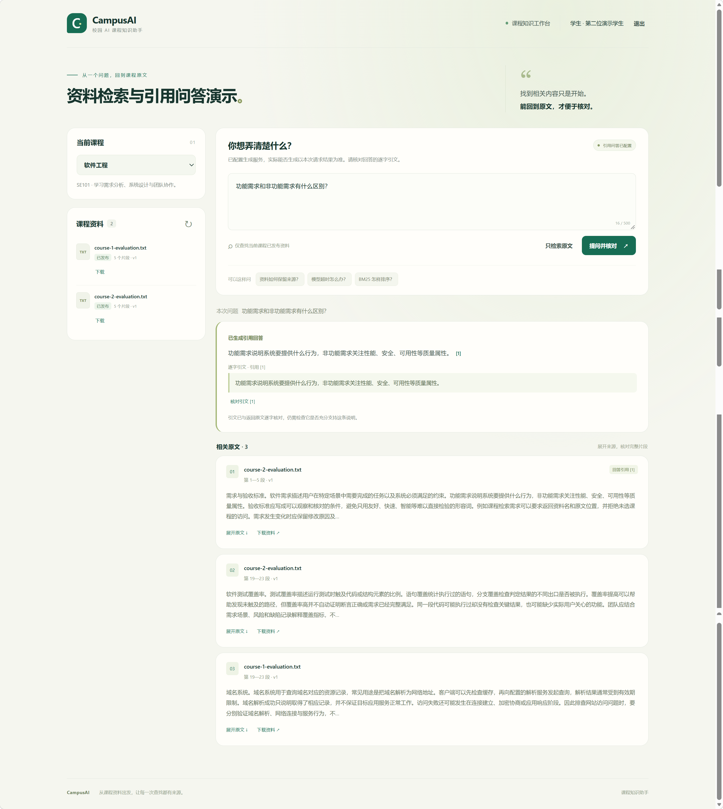
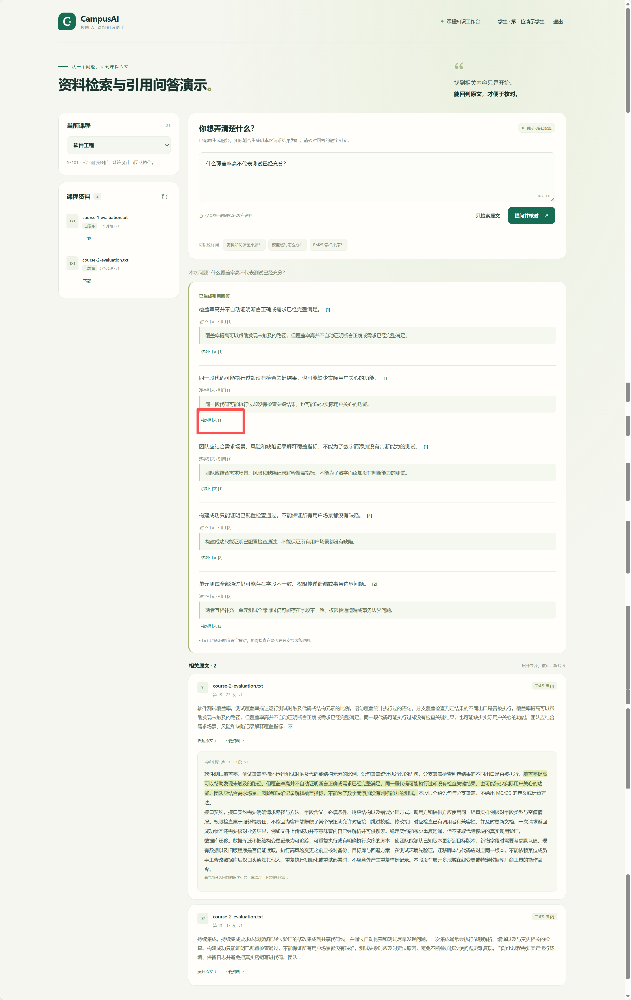

步骤 7：检查无依据边界。

- 输入样例中不存在的标识符 `QuantumZebraProtocol987`，点击“只检索原文”，预期无命中；再提问也不应编造资料引用。这只检查空结果路径，不代表语义能力全面合格。
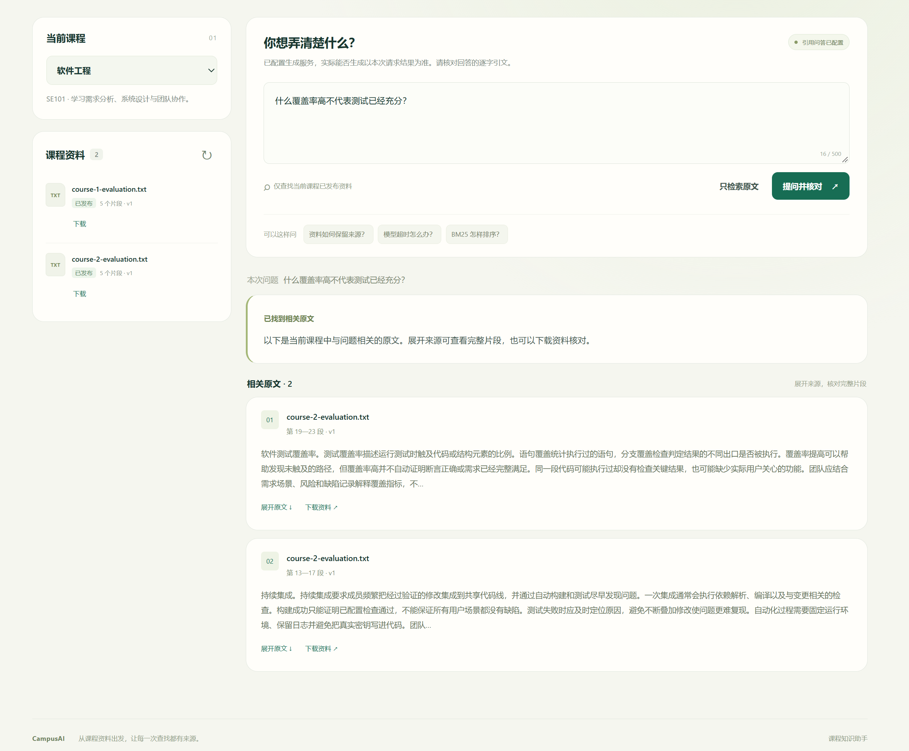
- 再问“软件测试中的 MC/DC 覆盖率如何计算？”。样例明确说明不提供该定义或计算方法。若模型提示依据不足，符合预期；若返回相关原文但没有回答计算方法，记录为回退/不足；若编造计算方法并把这段文字当支持依据，记录为语义质量缺陷。不能因为原文里出现 MC/DC 就认定问题已回答。
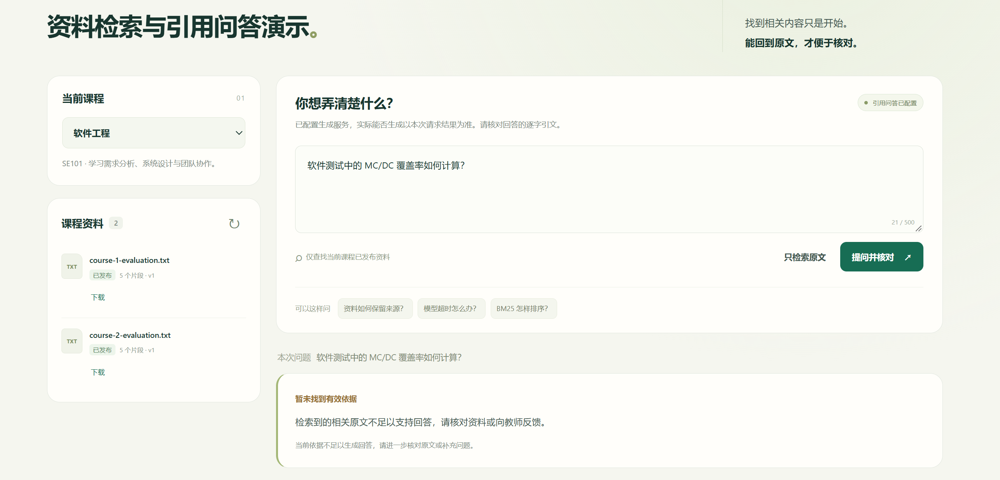
模型提示依据不足符合预期

通过标准：有依据问题至少取得可核对的真实 generated 结果，并保留每次样本的实际状态；无依据问题不被虚构引用包装成成功。此次样例检查不替代独立的模型质量评估。

## 方案 6：课程权限与资料生命周期

目的：检查草稿、下架、版本更新、旧引用失效和跨课程访问。

步骤 1：先运行方案 2 的 `verify-api.ps1` 与 `verify-rag.ps1`。它们已覆盖跨课程读取、学生管理操作拒绝、幂等重处理、旧版本发布/下载返回 409、下架与替换后的旧引用失效。

步骤 2：准备只用于本次验收的文件，避免操作正常资料：

```powershell
Set-Content -LiteralPath (Join-Path $env:TEMP 'campusai-main-lifecycle.txt') -Value 'MAINVERSIONALPHA 本次验收的初版资料，验收标记为甲。' -Encoding utf8
```

步骤 3：teacher 在“计算机导论”上传并发布该文件。student 查询 `MAINVERSIONALPHA`，保留结果页面；student2 的课程选择应只有“软件工程”。如果要检查直接越权接口，以脚本结果为准，不能只凭菜单隐藏判断服务端权限正确。

步骤 4：teacher 对该资料选择“更多 → 重新解析”。内容相同且先前解析成功时，版本和片段不应重复增加，发布状态保留。

步骤 5：teacher 下架。student 刷新后资料不可见，新检索不能命中，重新打开先前的来源/下载应被拒绝。已经显示在浏览器里的旧文本不会被服务器自动抹除，应检查下一次读取。

步骤 6：修改同一个测试文件：

```powershell
Set-Content -LiteralPath (Join-Path $env:TEMP 'campusai-main-lifecycle.txt') -Value 'MAINVERSIONBETA 本次验收的新版资料，验收标记为乙。' -Encoding utf8
```

teacher 选择“更多 → 替换文件”，上传这个新版。预期版本从 v1 变为 v2，并变成待发布。确认解析后重新发布；student 查询 `MAINVERSIONBETA` 应命中新版，旧引用不能读取旧版内容。

步骤 7：如需手工观察 409，在两个教师窗口中同时保留 v1 页面，一个窗口替换为 v2，另一个不刷新并尝试发布/下载。预期提示版本变化并刷新，而不是默默操作用户尚未看过的新版本。单纯发布或下架不增加内容版本，不应据此期待每次状态切换都有 409。

步骤 8：teacher 删除这份测试资料，student 刷新后不再能检索或读取它。仅删除该次测试文件对应资料。

通过标准：权限与生命周期脚本通过，页面状态与实际可访问性一致，替换后要求重新发布，旧来源和旧版本不继续有效。
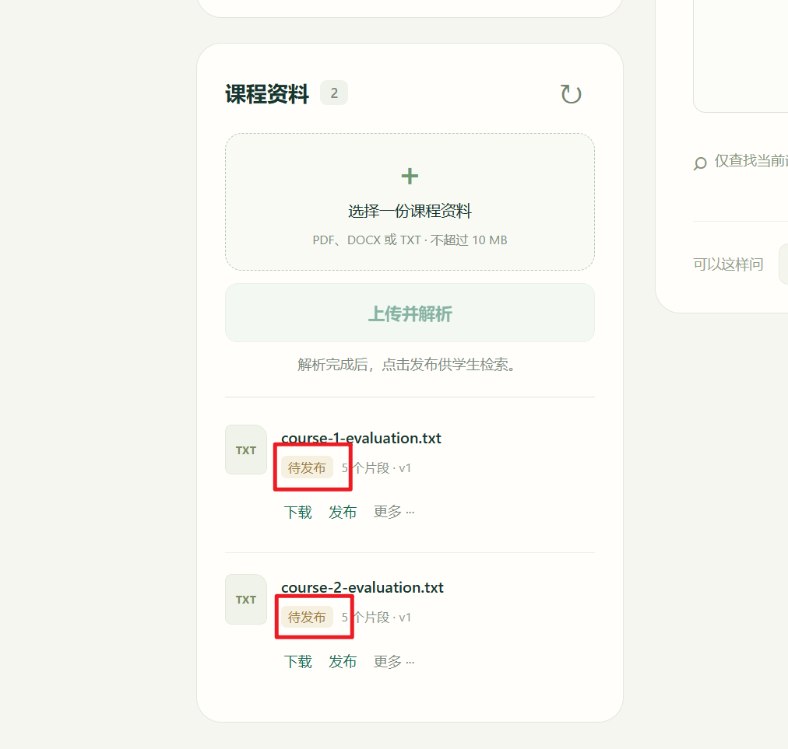

## 方案 7：前两个会话问题的合并后回归（暂未测试）

目的：确认 PR3 的修复进入 main 后仍有效。

步骤 1：方案 1 的 `npm.cmd test` 已包含这两个问题的 13 项回归。成功后无需反复执行，除非代码或环境发生变化。

步骤 2：手工检查“网络失败 → 重试时会话失效”。

1. 在管理后台 `http://127.0.0.1:5175` 用 teacher 登录，进入课程页。
2. 在浏览器开发者工具的 Network request blocking 中阻止 `*/api/campusai/courses`，然后刷新页面。身份请求仍可通过，课程页出现错误和“重新加载”。
3. 取消阻止，但先不刷新或点击重试。
4. 在 Console 执行以下代码，只撤销当前后台会话，不输出令牌：

```javascript
await fetch('/api/logout', {
  method: 'POST',
  headers: { Authorization: 'Bearer ' + sessionStorage.getItem('campusai-admin-token') }
}).then(response => response.json())
```

5. 返回 code200 后，点击“重新加载”。预期回到登录页，不能显示成“没有可见课程”。
6. 执行 `sessionStorage.getItem('campusai-admin-token') === null`，预期 true；重新登录应能恢复。

步骤 3：“旧请求晚到”由自动回归控制请求完成顺序，验证切换账号后旧成功响应、旧 401 与旧网络错误均不改变新会话。默认 admin/teacher 的可见课程相同，单纯目测课程列表不足以证明隔离，应以测试中的差异课程数据断言为依据。

如需在浏览器手工挂起旧响应，可参考当前仓库 `docs/pr3-session-fix-verification.md` 的第 4 部分 Console 脚本；使用本方案的 main 页面地址 5175。该旧文档里的 PR3 目录、18080 端口及“尚未提交”是修复时的历史记录，不适用于现在的 main 运行步骤。

通过标准：13 项自动测试通过，手工重试 401 正确返回登录，换号后没有被旧请求误退出。

## 方案 8：重启持久化与会话失效（暂未测试）

目的：确认启动脚本使用文件数据库，资料在 main 服务重启后保留，内存会话按设计失效。

步骤 1：在 RAG 页面记录方案 4 中一份已发布资料的文件名、资料 ID、版本、片段数，并完成一次检索。保留页面，不先退出。

步骤 2：在终端 A 使用 main 的脚本停止并重新启动：

```powershell
Set-Location 'E:\School Study\Software_Engineering\期末大作业\CampusAI'
pwsh -NoProfile -File .\scripts\stop-rag-demo.ps1 -Port 18082
pwsh -NoProfile -File .\scripts\start-rag-demo.ps1 -Port 18082 -SkipBuild -Background
```

步骤 3：旧页面重新请求课程资料或执行检索，预期提示登录失效并允许重新登录。管理员页面只有实际发出受保护请求时才能发现失效；仅查看静态示例页面不保证立即退出。

步骤 4：重新登录，检查记录的资料 ID、版本、发布状态、片段数及可检索内容仍保留。这里应比较记录的具体资料，不只看列表数量。

通过标准：资料保留，会话需要重新登录。如果改成默认 `mvn spring-boot:run` 或直接 java -jar 且未设置文件数据库，会使用默认内存库，不能用这种启动方式验收资料持久化。

## 补充方案 A：学生端 H5 和微信构建

适用：要检查当前主仓库三端基础能力时执行。不是完整学生问答端验收。

步骤 1：新开终端 C，从 main 安装学生端依赖。当前仓库没有学生端 package-lock.json，使用 npm install。

```powershell
Set-Location 'E:\School Study\Software_Engineering\期末大作业\CampusAI\student-miniapp'
npm.cmd install
Remove-Item Env:VITE_CAMPUSAI_API_BASE_URL -ErrorAction SilentlyContinue
$env:CAMPUSAI_BACKEND_URL = 'http://127.0.0.1:18082'
npm.cmd run dev:h5
```

步骤 2：打开 `http://127.0.0.1:5174`。student 只见 CS101，打开详情正确；退出后 student2 只见 SE101；错误密码拒绝；旧会话失效后回登录。

步骤 3：停止 H5 开发进程后构建：

```powershell
npm.cmd run build:h5
$env:VITE_CAMPUSAI_API_BASE_URL = 'http://127.0.0.1:18082'
npm.cmd run build:mp-weixin
```

步骤 4：微信开发者工具导入 `student-miniapp/dist/build/mp-weixin`，使用团队 AppID/测试账号，在本机调试环境配置合法域名检查后验证登录与课程。真机的 127.0.0.1 指向手机自身，真机网络配置另行处理，不纳入本机检查。

依赖首次安装会生成 package-lock.json；验证成功后再决定是否作为学生端依赖锁文件提交。不能把依赖下载失败记录成业务功能失败，也不能把 H5 成功当作微信端已验证。

## 补充方案 B：专门定位模型故障回退

方案 1 的完整后端测试已经覆盖模型超时、服务错误、非法 JSON/引文和问答期间资料失效。若只需要定位这部分，可以在 main 根目录单独运行以下命令，不需要在完整测试后机械重复：

```powershell
.\backend\mvnw.cmd -f .\backend\pom.xml "-Dtest=ModelGatewayTest,RagGenerationIntegrationTest" test
```

预期测试全部通过。这些用受控提供方检查超时和错误路径，不代表真实 DeepSeek 已可用；真实生成仍按方案 5 判断。无需为了验证回退而修改或破坏已经保存的个人模型配置。

## 常见问题定位

| 现象 | 下一步 |
| --- | --- |
| 18082 连接被拒绝 | 检查监听和 main 启动输出；先确认服务成功启动，不修改密码来解决建连问题 |
| RAG 页面可打开，管理后台登录报连接错误 | 核对 Vite 启动终端的 CAMPUSAI_BACKEND_URL=18082，并重启 Vite |
| 后台显示的资料与 RAG 页不一致 | 后台仍是模拟资料，这是当前集成边界 |
| main 资料列表为空，PR2 原本有资料 | 两个工作区的 H2 文件库不同，重新上传测试样例 |
| 模型显示已配置却只有原文 | 查看 ask 的 status/reason；区分 timeout、provider_error、invalid_response、invalid_citation 等 |
| 上传返回 code200 但解析失败 | 检查 parseStatus/errorMessage；业务请求成功不等于解析 READY |
| 文件锁/数据库被占用 | 确认没有两个 main 进程同时打开同一 backend/data/rag-demo 文件库 |
| 后端测试报告与页面运行不一致 | 确认测试后重新打包，停止旧 main 进程并启动新 JAR |

查看 main 日志：

```powershell
Set-Location 'E:\School Study\Software_Engineering\期末大作业\CampusAI'
Get-Content .\backend\target\rag-demo.log -Tail 80
Get-Content .\backend\target\rag-demo.stderr.log -Tail 40
```

## 验收记录模板与结束操作

每个方案至少记一行；失败时保留触发步骤和状态，不只写“不能用”。

| 编号 | main 提交 | 账号/课程 | 输入或操作 | 预期 | 实际状态、reason、错误 | 结果 | 截图/日志位置 |
| --- | --- | --- | --- | --- | --- | --- | --- |
| 1 自动测试 | | | 后端 verify、后台 test/build | 无失败 | | 待测 | |
| 2 HTTP | | | verify-api、verify-rag | 全部 PASS | | 待测 | |
| 3 后台 | | | 角色/课程/路由 | 按角色限制 | | 待测 | |
| 4 解析 | | | TXT/DOCX/PDF | 可发布检索，位置正确 | | 待测 | |
| 5 模型 | | | 有依据/无依据问题 | generated 与不足状态清楚 | | 待测 | |
| 6 生命周期 | | | 重处理/下架/替换/删除 | 旧来源、旧版本失效 | | 待测 | |
| 7 会话 | | | 旧响应、401 重试 | 新会话不受干扰，失效会话退出 | | 待测 | |
| 8 持久化 | | | 重启 | 资料保留、重新登录 | | 待测 | |
| A 学生端 | | | 登录/课程/构建 | H5 与微信分别记录 | | 待测 | |

记录中不要粘贴 API 密钥、Authorization 令牌或个人密码。主要结果应表述为“认证与课程、真实 RAG 链路、后台原型、会话修复通过”，不能写成完整业务产品已经完成。

检查结束：在前端终端 Ctrl+C；main 后端执行 `pwsh -NoProfile -File .\scripts\stop-rag-demo.ps1 -Port 18082`。这会停止服务，保留本次 main 文件数据库中的资料。
