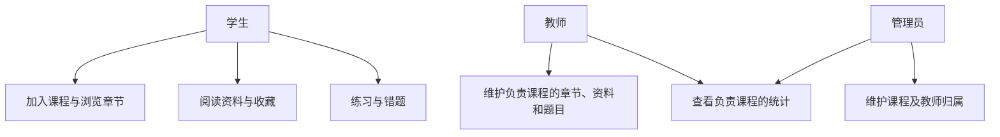
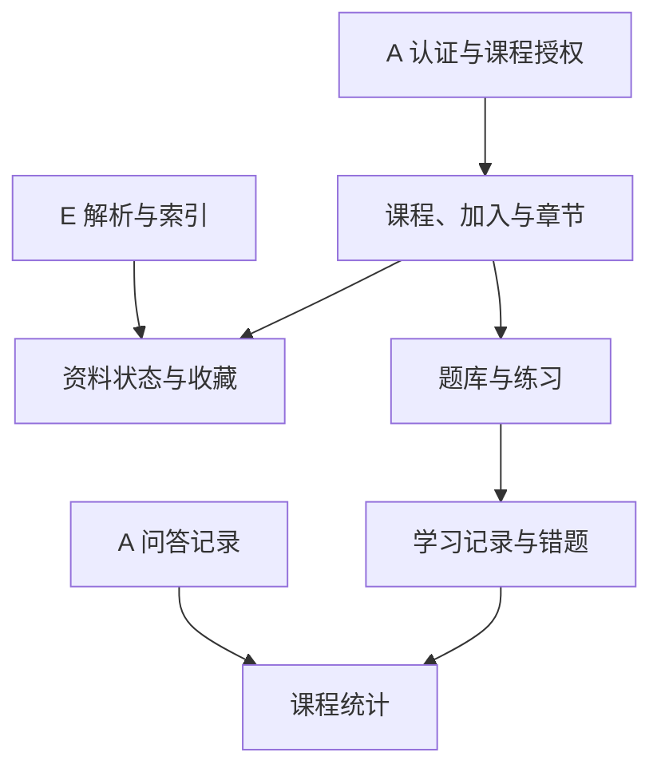

# CampusAI B 部分分工与第一周联调

2026 年 11 月 24 日 · B 陈用礼 · 核心业务后端

## 仓库基线

本次以 GitHub 的 [main @ 0257424](https://github.com/sjyEva/CampusAI/commit/02574248ab37e38eeacaf15bf81a8990fed9d8fa) 为基线。该提交增加 11 月 27 日汇报测试材料，其父提交是 RAG 合并提交。本周计划与验收标准见 [六周开发计划](six-week-development-plan.md) 和 [main 检查计划](CampusAI-main-check-plan.md)。

| PR | 核对结果 | B 的接入点 |
| --- | --- | --- |
| [#1 基础框架](https://github.com/sjyEva/CampusAI/pull/1) | 已合入 · 3740263 | 复用登录、角色和课程列表、详情 |
| [#3 后台第一周页面](https://github.com/sjyEva/CampusAI/pull/3) | 已合入 · 8a5461a | 接入现有课程页和章节弹窗，复用会话与错误处理 |
| [#2 解析、检索与引用问答](https://github.com/sjyEva/CampusAI/pull/2) | 已合入 · 10099b1 | 复用资料 UUID、解析状态、版本及发布状态 |
| [#4 PPT 与 Excel 解析](https://github.com/sjyEva/CampusAI/pull/4) | 开放待审 | 跟进合入后的格式与引用定位字段 |
| [#5 B 第一周联调](https://github.com/sjyEva/CampusAI/pull/5) | 开放待审 | 课程章节查询、学生端与管理后台接入、H2 初始化及联调说明 |

## B 的六周职责

| 周次 | B 的工作 | 交付与验收 |
| --- | --- | --- |
| W1 · 11/23–11/29 | 梳理课程、章节、资料、练习与统计流程。起草课程和资料接口及数据表。交付按角色可读的课程列表、详情和章节，提供本地数据联调入口 | C、D 使用相同字段与样例。F 可在干净环境初始化两门课及选课、章节数据 |
| W2 · 11/30–12/06 | 维护课程、教师归属与章节，支持学生加入课程。接入资料上传、章节归属、列表、详情、状态、失败重处理、发布、下架、下载及收藏 | 负责教师能发布解析就绪的资料。已选课学生能打开及收藏。另一门课的学生、解析失败和下架状态均纳入验收 |
| W3 · 12/07–12/13 | 单选题和判断题的维护、按课程或章节取题、提交和服务端判分。保存作答、学习记录和错题，为统计准备查询数据 | 取题隐藏答案与解析。重复提交同一作答返回原结果，作答记录只计一次 |
| W4 · 12/14–12/20 | 补全学习记录与错题查询。实现课程访问量、热门问题、客观题正确率，检查资料、题目和统计的数据一致性 | 教师只看负责课程，管理员可按课程查。说明统计口径并用初始化数据复算，覆盖空结果和重复请求 |
| W5 · 12/21–12/27 | 修复课程权限、资料状态、判分、错题和统计边界。与 F 复核数据库迁移和回归 | 覆盖跨课程隔离、失败重试、重复提交、历史数据与迁移 |
| W6 · 12/28–01/03 | 核对 API、表结构与业务设计，准备资料、练习及统计演示数据与个人贡献说明，参加业务流程与数据一致性答辩 | 文档字段与实际响应一致。使用演示记录核对分数、错题和统计值 |

| 协作方 | B 需要共同确认的事项 |
| --- | --- |
| A · 后端基础 | 账号、认证、课程授权与统一响应。六周计划由 A 负责问答历史、反馈和后台问答查询，W1 由 A、B 确认。B 的热门问题统计使用 A 提供的课程问答事件 |
| C · 学生小程序 | W1 登录后的课程列表、详情和章节。后续接入选课、资料、收藏、练习、记录与错题 |
| D · 管理后台 | W1 教师和管理员的课程及章节读取。后续接入课程、章节、资料、题库和统计维护 |
| E · 解析与问答 | 复用资料 ID、解析结果、发布标记及版本。上传、发布、重处理和读取原文均走同一份资料状态 |
| F · 数据库、测试 | 核对业务表外键、迁移及样例。B 提交本模块的脚本和测试，F 核对跨模块关系与部署复验 |

## 业务用例



学生加入课程后查看章节。负责教师在章节下上传讲义，解析并确认状态后发布。学生浏览资料并完成练习。后端核对课程和题目归属，按题目版本判分并保存作答。教师和管理员从同样的作答、访问与问答记录复算统计。

## 功能模块



## 第一周接口与数据

课程接口使用 Bearer 令牌，先用 `POST /login` 获取。三个读接口共用角色范围。学生看已加入的课程，教师看负责的课程，管理员可查所有课程。

| 方法和路径 | data |
| --- | --- |
| GET /campusai/courses | 课程数组，每项为 id、courseCode、name、description |
| GET /campusai/courses/{id} | 同上字段的单个对象 |
| GET /campusai/courses/{id}/chapters | 章节数组，每项为 id、title、sortOrder。按 sortOrder 升序，同序时按 id 升序 |

沿用 HTTP 200 加 JSON 业务码的现有约定。业务码 200 表示成功，401 表示令牌缺失或失效，400 表示 ID 无法解析，404 表示课程不存在或在当前账号可见范围之外。可访问的课程没有章节时返回 200 和空数组。

用课程 1 读取章节时，初始化库返回以下数据。

```json
{
  "code": 200,
  "msg": "操作成功",
  "data": [
    {"id": 102, "title": "课程导论", "sortOrder": 1},
    {"id": 101, "title": "计算机系统基础", "sortOrder": 2}
  ]
}
```

| 账号 | 课程 | 章节 ID |
| --- | --- | --- |
| student | CS101（1） | 102、101 |
| student2 | SE101（2） | 201 |
| teacher、admin | 两门课程 | 按所选课程返回 |

## 数据库与本机复现

默认是仓库已有的本地 H2 内存库。Spring Boot 自动执行 [schema.sql](../backend/src/main/resources/schema.sql) 与 [data.sql](../backend/src/main/resources/data.sql)，创建表和演示数据。章节表按课程外键关联，两门课有不同章节，重复启动时保留既有同 ID 数据。默认实例重启会重新初始化，登录会话也需要重建。单机演示可使用下方配置将业务数据写到本地文件，令牌依然存于进程内。

在仓库根目录使用 PowerShell 启动：

```powershell
mvn.cmd -f backend/pom.xml spring-boot:run
```

需要持久保留资料和章节时，在同一个终端先设置文件库再启动。此处使用仓库根目录下的本机文件，仓库已忽略 H2 数据库文件。

```powershell
$database = (Join-Path (Get-Location) 'data/campusai').Replace('\', '/')
$env:CAMPUSAI_JDBC_URL = "jdbc:h2:file:$database;MODE=MySQL"
mvn.cmd -f backend/pom.xml spring-boot:run
```

在另一终端运行测试及 HTTP 验收：

```powershell
mvn.cmd -f backend/pom.xml test
pwsh -NoProfile -File .\scripts\verify-api.ps1
```

启动两端的命令与端口见 [运行说明](run-guide.md)。在学生端用 `student` 和 `student2` 分别打开课程详情，检查各自的课程和章节。在后台用 `teacher` 或 `admin` 登录，从「课程与章节」打开两门课，核对章节标题和顺序。课程新建与章节写入排在 W2。

## 第一周联调记录

- 使用 Java 21 运行 Maven，后端 87 项测试通过，成功生成可执行 JAR。
- 默认 H2 内存库启动后，四个账号的真实 HTTP 检查全部通过，覆盖课程列表、详情、章节顺序、权限范围及退出登录。独立 H2 文件库重启后保留已修改的章节顺序，样例数据没有重复，原令牌失效。
- Edge 浏览器访问学生 H5 和管理后台，分别用两个学生账号及教师、管理员完成真实登录、查看章节和退出。两名学生直接访问对方课程均收到权限提示。
- 管理后台、学生 H5 和微信小程序构建通过。微信开发者工具和真机运行仍需团队 AppID。A、B 需确认问答历史分工，F 需核对业务表草案。

## 后续业务 API 草案

下表路径均以 /campusai 开头。以第一周实装的课程字段为基础，后续字段、分页和统计口径由 B 与相关成员按周确认。

| 接口 | 设计 |
| --- | --- |
| POST /courses · PATCH /courses/{courseId} | 管理员创建课程并指定教师。负责教师可修改课程基本信息。维护课程状态及访问入口 |
| POST /courses/{courseId}/join-code · POST /courses/join | 管理方生成或重置加入码。学生凭加入码加入课程，重复请求保留一条选课记录 |
| POST /courses/{courseId}/chapters · PATCH /courses/{courseId}/chapters/{chapterId} | 教师或管理员维护章节标题及排序，按路径中的课程检查归属 |
| /courses/{courseId}/rag/materials | 现有列表、详情、上传、替换、重处理、发布、下架与文件下载。W2 增加章节归属和业务展示字段，列表可按章节筛选 |
| PUT /courses/{courseId}/materials/{materialId}/favorite · DELETE 同路径 | 学生收藏与取消收藏。收藏按用户和资料去重，列表和详情读取继续应用课程及发布权限 |
| /courses/{courseId}/questions | 教师或管理员维护单选及判断题，保存题干、选项、答案和解析，支持按章节筛选 |
| GET /courses/{courseId}/practice · POST /courses/{courseId}/attempts | 学生取题时返回题干和选项。提交带作答标识及答案，后端校验当前课程和题目归属并保存判分明细 |
| GET /courses/{courseId}/learning-records · GET /courses/{courseId}/mistakes | 学生查自己的作答与错题，按时间分页 |
| GET /courses/{courseId}/statistics | 负责教师和管理员按课程及时间区间查询访问量、热门问题和练习正确率 |

现有资料接口详细见 [RAG API](rag/api.md)。上传接收 multipart file，响应包含 id、courseId、filename、parseStatus、published、version、chunkCount、errorMessage。FAILED 为已保存的解析失败状态，只有 READY 的资料可发布。用同一资料的当前 version 下载或重处理，发布和下架传 expectedVersion。版本冲突返回 409，客户端刷新状态后由用户确认。已发布且 READY 的资料可供有权限的学生读取及检索。

## 业务表草案

| 表或实体 | 关键字段和约束 | 周次 |
| --- | --- | --- |
| campus_course | id、唯一 course_code、名称、说明、教师归属。当前按 teacher_username 查询 | W1 读，W2 补写入与加入码、状态 |
| campus_course_enrollment | course_id 关联课程，当前以 course_id、student_username 为复合主键 | W1 样例，W2 加入写入 |
| campus_course_chapter | id、course_id 外键、title、sort_order | W1 初始化与读，W2 写 |
| rag_material · rag_chunk | 使用现有资料 UUID、课程、解析及发布状态、version 和原文位置。与 E、F 确定章节关联迁移 | PR #2 已入库，W2 接业务端 |
| material_favorite | student_id 与 material_id 唯一组合 | W2 |
| question · question_option | 课程及可选章节归属、题型、题干、选项、标准答案、解析及变更版本 | W3 |
| practice_attempt · practice_answer | 作答归属和提交标识唯一，记录判分时答案依据与得分。错题查询按作答明细及当前用户过滤 | W3–W4 |
| course_visit · 问答事件 | 课程访问流水、时间和参与者。热门问题读取 A 的课程问答记录 | W4 |

账号表完成后，教师和选课关系需要与 A、F 迁移到稳定账号 ID。章节和资料都带课程归属，上传和改挂章节时应在后端校验两者属于同一课程。

统计口径草案供 B、D 在 W4 核对。课程访问量统计学生成功打开课程详情的次数。热门问题读取 A 保存的课程提问记录，按同一提问文本的次数排序。练习正确率使用答对题数除以有效作答题数，作答题数为零时正确率为空。同一个作答标识重试只计一次。
