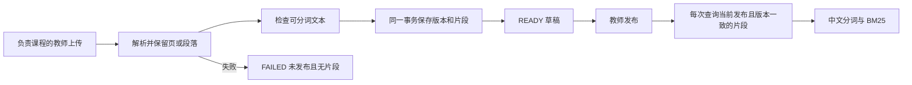
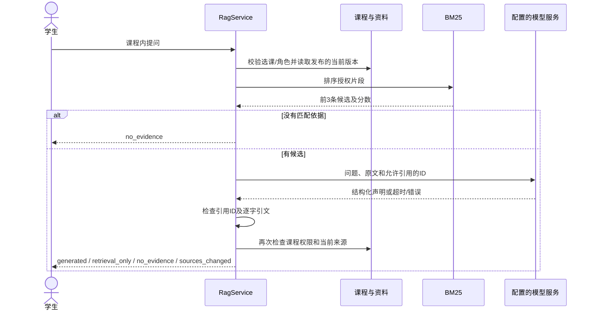

# 杨宇轩：解析、BM25 与引用问答模块

本模块对应六周计划中的 E 职责，基于现有 Spring Boot 后端、演示账号和课程权限运行。包含三类文件解析、带位置的片段、中文 BM25、可配置的模型适配、引用校验、故障回退、固定题集和独立演示页。上传、发布等入口是便于 A/B 联调的最小资料适配器，未替代组员的章节、收藏、题库、历史或两端业务页面。

[接口约定](api.md) · [实际验证记录](verification.md) · [固定评估](evaluation/README.md)

## 运行和演示

需要 Java 17 或 21。后端目录中的 Maven Wrapper 可在没有全局 Maven 时下载并使用 Maven，首次运行需要联网。

```powershell
# 在仓库根目录执行
Set-Location backend
.\mvnw.cmd test
.\mvnw.cmd spring-boot:run
```

打开 <http://127.0.0.1:8080/rag-demo.html>。也可以在仓库根目录运行 `./scripts/start-rag-demo.ps1`，默认使用 18080 端口和 H2 文件库，保留本次演示上传的资料。账号和登录令牌仍沿用项目开发配置，服务重启后需重新登录。

演示步骤：

1. 用 `teacher` 登录，默认密码 `CampusAI-Dev-2026`；如果配置了 `CAMPUSAI_DEV_PASSWORD`，输入该值。
2. 选择“计算机导论”，上传 [parsing-demo.txt](samples/parsing-demo.txt)、[parsing-demo.docx](samples/parsing-demo.docx) 或 [parsing-demo.pdf](samples/parsing-demo.pdf)。页面显示解析结果；解析成功后点击发布。
3. 用 `student` 登录，选择“计算机导论”，询问样例中的问题，例如“模型服务不可用时系统如何处理”。核对返回原文、文件名、页或段落范围，并打开来源或下载原文件。
4. 当前未配置实际模型时显示“仅返回课程原文”。这是实际检索回退，不是假造的模型回答。英文 PDF 可询问 `How does BM25 rank text?`。
5. 用 `teacher` 下架资料，再次查询/打开旧来源应失败；替换文件后必须重新发布，旧引用失效。用 `student2` 登录只能访问软件工程课程，不能读取计算机导论资料。

`scripts/verify-rag.ps1` 会通过实际 HTTP 上传自编文本并检查发布、检索、来源、课程隔离、替换和删除。脚本只清理自己创建的资料，密码可从同一环境变量读取。

```powershell
.\scripts\verify-rag.ps1 -BaseUrl http://127.0.0.1:18080
```

## 模块结构与交接

| 类或文件 | 职责 |
| --- | --- |
| `DocumentParser` | 文件解析、文本规范化、700 字符分片和来源位置 |
| `RagMaterialService` | 最小入库适配；事务内替换片段、失败状态、重处理、发布及失效 |
| `RagRepository` | `rag_material` / `rag_chunk` 持久化及当前可检索片段查询 |
| `Bm25Engine` | SmartChineseAnalyzer 中文分词、BM25 打分、词项覆盖率过滤 |
| `RagService` | 课程权限、搜索、模型编排、调用后再次核对来源资格 |
| `ModelGateway` | OpenAI 兼容协议、结构化声明及引用校验、超时和故障处理 |
| `RagController` | `/campusai/courses/{courseId}/rag` 下的真实接口 |
| `static/rag-demo.*` | 独立模块演示页，直接调用上述接口 |

A 可调用 `RagService.ask(account, courseId, question)` 并保存问答历史/反馈，返回值中的 `status/answer/citations/evidence/reason` 可直接作为记录内容。当前模块没有伪造 `recordId`，历史和反馈仍由 A 接入。

B 可调用 `RagMaterialService` 接入资料业务。现有适配器返回 UUID `materialId`；若业务另有资料 ID，应显式建立映射。**发布状态必须只有一个权威来源**：现阶段是 `rag_material.published`，不应复制第二份不联动的状态。后续整合到 B 的主资料表时，将当前 SQL 的状态/版本判断一起迁移或在同一事务内同步，不能只异步删除索引。

F 需复核新增表迁移及正式 MySQL 环境。当前脚本采用 H2 MySQL 模式和 MySQL 可用类型；实际验证数据库见评估记录。`schema.sql` 只增加两张模块表，不改变现有课程/选课表。文件二进制暂存数据库，适合课程演示；团队接入 MinIO 等对象存储时保持授权下载入口，不能暴露未授权静态文件地址。

## 解析、索引与状态

单文件上限 10 MB；PDF 最多 200 页；总提取文本最多 100 万字符。TXT 严格要求 UTF-8，支持 BOM；每一物理行作为段落，空行仍占编号。DOCX 按正文、表格行及单元格顺序编号，识别 Heading/标题样式；页眉、页脚、批注、文本框不在当前提取范围。PDF 使用真实页码，不跨页合并；DOCX/TXT 使用段落范围，不承诺页码。

按段落/句子优先切分，最长 700 个 Java UTF-16 字符，不拆开 Unicode 代理对；合并片段保留覆盖的段落范围和标题。PDF 扫描件、加密件、损坏或格式不符文件会返回失败；不执行 OCR。DOCX 同时有解压大小、内部文件数和嵌套深度限制。



处理状态 `PROCESSING/READY/FAILED` 与 `published` 分开。解析在同步事务中完成，其他请求一般观察到的是最终状态；没有虚构后台任务队列。失败保留错误信息，不留可检索半成品。对已成功解析的同一资料重传相同文件名、内容摘要和解析版本，或成功后的重处理，是幂等操作，片段编号和版本不变；FAILED 重试会重新处理并递增版本。每次新建上传会创建独立资料，客户端不应把重复 POST 当作重试原资料。

内容或文件名变化会递增版本、撤下资料并删除旧片段，新内容需重新发布。下架、删除及更新通过数据库当前状态立即影响下一次查询。相同资料的重处理/发布/删除使用行锁串行化，避免互相覆盖。源码 `PARSER_VERSION` 表示解析/分词契约版本，改变切分或词项策略时应递增，再调用重处理入口。

片段保存在数据库。为了让课程范围小、资料量有限的演示可复现，每次搜索从当前授权片段重建内存词频统计，没有额外的异步磁盘索引。服务重启不依赖遗留缓存；内存 H2 默认会丢数据，文件 H2 或数据库配置才可保留。资料量显著增大时应改为持久索引并继续保留数据库资格校验，当前实现不声称大规模检索性能。

## BM25 参数和评估

使用 Apache Lucene `SmartChineseAnalyzer`，NFKC 规范化及小写化，移除常见问句虚词。文档词频保留重复次数，问题词项去重。BM25 参数 `k1=1.2`、`b=0.75`；IDF 为 `ln(1+(N-df+0.5)/(df+0.5))`。N 是当前课程中有有效词项的片段数，长度和平均长度均按分词后的词项数计算。

额外词项覆盖门槛默认 `0.5`，定义为“命中的不同问题词项数 / 问题的不同词项总数”。它减少弱匹配，但不是答案置信度，也不能证明原文支持答案。BM25 分数不应跨问题比较；词面相近但答案缺失仍会误召回。最多 500 字符、64 个不同问题词项，topK 为 1–10；问答固定取前 3 条。

固定数据、首次逐题结果和已知误召回见 [evaluation/README.md](evaluation/README.md)。本轮题集由开发侧自编并固定，尚未由 F 独立保管/复核，因此不能当作独立盲测或真实课程效果。验收集不用于本轮调参。没有实现向量混合检索、重排序、多轮对话或 OCR；这些仍在六周计划的后置范围。

后续改进加入[显式技术标识符匹配](evaluation/identifier-improvement.md)：查询点名 `MC/DC`、`BM25`、`C++` 等标识时，候选原文必须包含该标识，减少分词拆散后的误召回。该规则仍是词面过滤，可能漏掉只写中文全称的资料，也不能判断“资料不介绍某概念”等否定语义。原始 40 题与首次结果保留，后续比较明确标为已知样例回归，不能再次当作未见验收。

## 模型配置及返回边界

后端直接读取环境变量；不会自动加载 `.env` 文件。没有密钥也可运行解析和检索。模型请求发生时，问题和最多三个授权片段会发送到所配置的服务。

| 环境变量 | 示例/默认值 |
| --- | --- |
| `CAMPUSAI_MODEL_BASE_URL` | `https://your-provider.example/v1`，程序追加 `/chat/completions` |
| `CAMPUSAI_MODEL_API_KEY` | 本机环境变量中的凭证；本地无认证服务可为空 |
| `CAMPUSAI_MODEL_NAME` | 提供方支持的模型名 |
| `CAMPUSAI_MODEL_TIMEOUT_SECONDS` | `10`，允许 1–60，包含读取完整响应体 |
| `CAMPUSAI_RAG_MINIMUM_COVERAGE` | `0.5`，允许大于 0 且不超过 1 |

远程服务要求 HTTPS，回环本地服务允许 HTTP；关闭重定向。响应上限 128 KiB，不对用户暴露服务商错误正文或密钥。输入资料以不可信数据发送；模型只能输出结构化 `claims`，每条含说明、授权片段 ID 和逐字引文。服务端检查 ID 属于本次候选、引文至少四个 Unicode 码点且确实出现在片段内，并生成 `[1]` 等编号。不接受虚构 ID、无引文、损坏 JSON、截断输出、工具调用或模型自造引用编号。

已校验引文及 UTF-16 位置随每条声明返回，页面可逐条核对并在重新授权的原文中高亮。下载和资料操作携带页面所见版本，版本冲突返回 409 并刷新，不自动覆盖或发布未看过的新版。页面从能力接口读取配置状态与问答等待上限，避免前端 45 秒超时截断后端允许的 60 秒模型请求；“已配置”不等于实际服务可用。

**引用存在、引文相符，不等于生成说明必然正确。** 当前没有语义蕴含判定器，真实模型的答案质量仍需人工核查。此次没有配置真实模型额度，成功与故障路径通过本地受控 HTTP 服务测试；不能据此宣称商业模型效果或可用性已经验证。



## 个人完成范围与仍需协作的事项

本次实现了 E 的解析、来源、BM25、模型协议、引用校验、回退、模块测试、开发评估及说明，并提供可调用接口和独立演示入口。实际验证结果以测试记录为准。

团队后续需要将 C/D 正式页面接入这些接口，A 保存历史与反馈，B 整合资料/章节业务，F 复核数据库和独立验收题集，并在选定模型服务后进行真实提供方验证。未将这些组员工作或项目的六周里程碑标记为已经完成。
