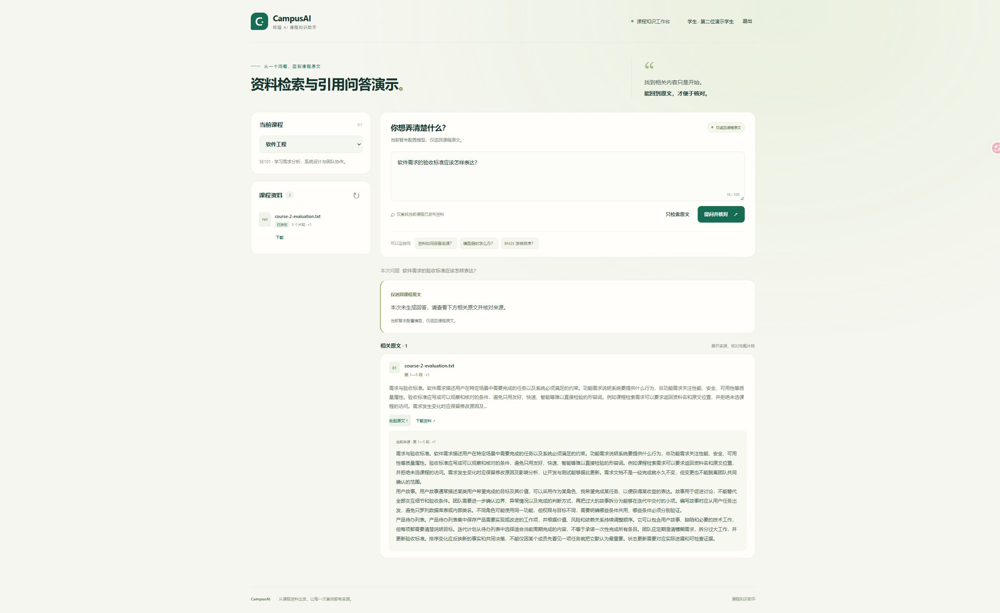

# 模块验证记录

## 第二周章节关联、预览与联调交接（2026-11-27）

基于主分支 `39851812ff6d22c85ea6f105da10b19577cebbb4`，在独立工作目录保留并整合前次真实流式改动，新增可选章节归属、章节资料筛选及受权限/内容版本约束的分页文本预览。原工作目录及公网演示进程未被本轮替换。PR #8 当前仍开放，已核对其预览协议；本次加强实现保留在原 `RagController`，合并注意事项见 [第二周交接](week2/README.md#pr-8-预览评审与合并)。

JDK 17 完整 `clean package`：**155 项后端测试通过，0 失败、0 错误、0 跳过**；前端流解析 **5 项通过**。新增章节接口 6 项、旧库增量迁移 1 项、预览接口 19 项。覆盖章节跨课程拒绝、旧上传兼容、绑定/清除不改内容和引用、替换保留章节、类型与版本校验、关联删除约束；旧库重复执行迁移保留选课、资料 UUID、文件字节、版本和来源位置。预览覆盖分页、序号缺口、整数上界、七种扩展名位置以及查询后下架/替换/删除/撤销选课/解析状态改变。第一次章节定向测试有两项使用未命中的检索词导致测试取空；改为已有明确原文的测试题后复测及最终完整构建通过，未为测试改变检索算法。

在独立回环端口启动打包 JAR，使用 H2 文件库、关闭模型配置，实际运行 `scripts/verify-rag-week2.py --keep`：**127 项检查全部通过，模型请求 0 次**。真实上传自编 PDF、DOCX、TXT，检查解析/章节/发布/搜索/位置/来源/预览；各格式均验证重复处理、下架、替换、旧版本和旧引用、删除；另验证损坏 PDF 的失败状态、禁止发布、失败重试与有效文件修复。脚本只清理本次临时资料，并保留三份最终样例供后续本机复核。固定题、文件哈希、测试汇总及本机样例 ID 见 [verification.json](week2/verification.json) 和 [cases.json](week2/cases.json)，复跑会生成不同 UUID。

随后只重启该隔离实例，使用同一 H2 文件库和重新登录的学生账号核对三份样例：资料 UUID、章节关联、内容版本、原文来源及预览内容均保持一致。另外在验收脚本第二份最终保留样例上传前主动注入连接失败，确认该轮自建临时资料全部清理、失败报告不再列出已删除样例，原有三份资料保持不变。上述结果是本机服务端及 HTTP 验证，不等于正式 MySQL、微信真机、两端联合流程或共享测试环境已经验收；新注册学生、服务端收藏及第二位教师账户仍由 A/B/F 的本周工作衔接。个人模型密钥、令牌、账号密码、老师课件和运行数据库不进入仓库。

## 真实流式问答与软件工程课件演示（2026-11-27）

新增 `POST /campusai/courses/{courseId}/rag/ask/stream`，实际向模型发送 `stream:true`；前端按到达的 SSE `delta` 显示待校验草稿，最终仍执行逐字引文、课程权限和资料版本核对。原 `/ask` 接口保持兼容。前端没有答案缓存、预设回放或打字计时器。连接取消、超时、引用失败或资料状态改变时，不保留未经最终核对的草稿。

本轮隔离构建的 13 份 Surefire XML 最终合计 **126 项通过，0 失败、0 错误、0 跳过**；新增流式网关 6 项和真实 Tomcat SSE 集成 5 项。首次全套运行的评估测试因构建目录未复制固定题集而报错，补齐 `docs/rag/evaluation/questions.json` 后仅重跑该项并打包通过。前端 SSE 解析测试 **5 项通过**，JavaScript 语法检查通过。43 份源码/资源哈希与构建副本一致，JAR 内编译类和资源与构建输出一致，`git diff --check` 通过。

使用独立本机 H2 文件库，通过真实演示页面上传用户课程资料 `SE01软件工程 .pptx`（SHA256：`211576208c69dcbc16979dda47509f49b33e7796fd78087b5f21413b87f63a3d`），实际解析为 **61 个片段**并发布。输入“软件工程方法学中的方法、工具和过程分别指什么？”，本次浏览器仅发出 **1 次流式问答请求**，实际调用已配置的 DeepSeek。约 **3.1556 秒**出现首段正文，约 **3.8468 秒**完成；观测到 **52 次页面文字更新**，这不是模型 token 数。最终状态为 `generated`，三条声明均对应第 **55 张幻灯片**，三条逐字引文已与原 PPT 文本复核，点击引用后页面显示同页来源并高亮原文。以上延迟仅为这一次调用，不能视为稳定性能指标。

录屏保留首次模型请求的完整等待与生成过程，引用展开另录为后续片段；成片仅剪去操作空档，没有加速模型输出，也没有用保存答案回放。原课件、录屏、浏览器证据和模型配置均留在本机，不加入 Git。本轮只在独立本机端口验证新版本，没有据此宣称既有公网服务已升级。引用文字相符仍不等同于通用语义正确率，独立质量评估和正式两端联调尚待完成。

验证环境：Windows 11，Oracle JDK 17.0.15，Maven Wrapper 3.9.14，Spring Boot 3.5.4。自动测试使用隔离的 H2 MySQL 模式内存库；实际演示使用 `jdbc:h2:file:./data/rag-demo;MODE=MySQL`。没有连接正式 MySQL 服务器。初始演示未配置模型，后续真实 DeepSeek 验证见下节。

## PPT 与 Excel 支持（2026-11-24）

在已合并前一版 RAG 的主分支 `0257424` 上补充 `.ppt/.pptx/.xls/.xlsx`。后端完整测试及打包于 16:07 完成：**115 项通过，0 失败、0 错误、0 跳过**。其中新增 `OfficeDocumentParserTest` 22 项和 `OfficeRagApiTest` 7 项，其余 86 项为既有解析、检索、模型协议、权限及账号回归。命令为 `./mvnw.cmd -B test package`，日常复现可直接使用 `./mvnw.cmd -B package`。

新增测试使用 POI 实际生成两代 PowerPoint 和 Excel 文件，核对文本框、表格、嵌套分组、实际幻灯片序号、隐藏内容、工作表隔离、稀疏 A1 地址、格式化数字和日期、1904 日期体系、公式已存缓存、长单元格与 Unicode 边界。同时验证四种加密 Office 文件均拒绝、损坏与格式错配失败、容量及解压限制。Excel 的公式在测试样例制作时计算一次，产品解析不执行公式；另有修改输入但保留旧缓存的测试，确认读取的是保存结果。

接口集成覆盖四格式上传到 READY 草稿、发布后检索、来源字段与数据库记录一致、问答原文回退、下载原字节、课程隔离、禁止学生上传、下架失效。PPTX 替换为 XLSX 后旧来源失效且位置行被清理；损坏替换不留下可检索片段；旧 TXT 没有扩展表记录时仍保留原段落位置。

随后使用打包 JAR 在隔离回环端口和 **H2 文件数据库**上做真实 HTTP 验证，未使用个人账号、个人模型密钥或模型额度：

- 先启动 11 月 23 日旧 JAR，上传并发布 TXT；关闭旧服务后用新版打开同一个文件库。新位置表自动补建，旧来源 ID、原文、版本和段落字段保持一致，Office 新字段为 `null`。
- 实际上传并发布仓库中的四份 `parsing-demo` Office 文件，查询“引用定位”。PPT/PPTX 返回原第 2 张幻灯片；XLS/XLSX 返回“课程资料”工作表 `A1:F7`，正文包含 `B3` 的说明和 `F7: 25.00%`；另核对“发布流程”工作表 `A1:C5`，没有跨工作表混合。
- 来源接口与检索中的 Source 一致；四种格式下载字节与原文件一致；另一课程学生访问来源返回业务 404。未配置模型时真实 `/ask` 返回 `retrieval_only/unconfigured` 和带新位置字段的原文。
- 再关闭并重启新版服务，用新登录令牌重新读取四格式来源和搜索结果，全部与重启前一致。这是文件 H2 的持久化验证，不代表正式 MySQL 已完成验收。

本轮前端仅扩展选择/替换文件类型、校验提示和来源位置显示，`node --check` 通过；没有改动批量上传、菜单关闭行为或管理后台视觉样式，也未将本轮浏览器视觉检查标为已完成。Office 在线预览/跳转、图片 OCR、图表和公式重计算不在此次实现范围。

本地原始结果在 `backend/target/office-full-tests.log`、`backend/target/surefire-reports/` 和 `backend/target/office-smoke/result.json`，均不纳入 Git；四份自编样例及生成器、自动测试已随代码提供。既有固定检索题集与评估结果未修改。

## DeepSeek 接入与公网联调（2026-11-23）

12:36 完整后端测试 **86 项通过，0 失败、0 错误、0 跳过**：原有 68 项、新增两个模型请求参数测试和 16 项独立演示账号测试。打包通过。测试使用本地受控提供方，不读取个人密钥或消耗模型额度。

在本机加密配置后，通过真实后端提问「软件需求的验收标准应该怎样表达？」得到 `generated`，首次返回 6 条声明，约 3.04 秒。通过公网 HTTPS 入口重新登录提问，得到 5 条声明，约 2.20 秒；逐条验证引用编号、来源 ID 与 UTF-16 引文位置。模型输出可能变化，这些单次延迟和声明数量不是稳定性指标。

对「软件测试中的 MC/DC 覆盖率如何计算？」进行真实调用：检索有相关候选但未覆盖计算方法，模型返回空声明，最终状态为 `no_evidence/insufficient_evidence`，没有生成声明。这是一个实际拒答样例，不表示所有无依据问题均能正确识别。

公网页面返回 200，未登录读取能力接口返回业务 code401，软件工程学生跨课程访问返回 code404。当前运行环境使用四个独立随机密码，默认开发密码不能用于公网登录。模型密钥经 Windows 当前用户加密，仅传入后端进程环境；对可提交代码、前端 JS、运行日志、实际响应与进程参数的密钥匹配扫描未发现泄露。临时网址、用户密码、密钥和个人配置不写入此记录或 Git。

12:51 实际验证启动与停止：活动隧道存在时，重复启动后端或隧道均被拒绝，原有进程和状态文件保持不变。停止绑定的后端进程后，看护进程自动关闭隧道并退出，旧公网地址及访问说明文件被移除。此检查实际执行了进程退出，不只是静态代码审查；随后重新启动受保护实例供组内使用。

本轮通过 HTTP 验证实际模型与公网访问，没有将先前未完成的新增高亮界面/窄屏浏览器复核标为完成；模型答案语义仍需人工评估。

## 自动化检查

首轮完整验证于本地时间 10:38 完成：52 个测试通过。加入本轮版本保护、能力接口和逐条引文后，再执行 `./mvnw.cmd -B test`，11:08 的完整运行为 **68 个测试，0 失败、0 错误、0 跳过**。

随后检索规则补充了全大写英文整句、CamelCase 名称及单字母语言名边界；11:12 对 `Bm25EngineTest,RetrievalRegressionTest,RagEvaluationTest` 定向复跑，**18 个测试全部通过**，其余后端代码未再变更。可执行 JAR 重新打包成功。

| 测试类 | 数量 | 主要验证行为 |
| --- | ---: | --- |
| `CourseAccessTest` | 4 | 原有登录、角色、选课范围和注销回归 |
| `DocumentParserTest` | 9 | 真实 PDF/DOCX/TXT、位置、表格、分片、重复性、加密/损坏/大小及解压边界 |
| `Bm25EngineTest` | 8 | 独立数值公式、中文匹配、空结果、查询去重、长度归一、门槛与确定排序 |
| `ModelGatewayTest` | 21 | 本地 HTTP 协议、成功结构、超时（含慢响应体）、服务错误、错误 JSON、非法引用、逐字引文和 Unicode 位置 |
| `RagApiTest` | 8 | 资料生命周期、失败无半成品、权限、严格 JSON 类型、旧版本写入/下载拒绝、能力接口 |
| `RagGenerationIntegrationTest` | 8 | 本地模型与真实问答入口、跨课程候选隔离、等待期间下架/替换/删除/撤销选课、失败回退 |
| `RagEvaluationTest` | 1 | 运行固定 40 题，记录逐题结果、来源和首次数据哈希 |
| `RetrievalRegressionTest` | 9 | 技术标识符、符号语言名、版本、普通中英文查询及保守漏召回边界 |

测试报告原始输出位于本地 `backend/target/surefire-reports/`；重新执行会产生新报告。固定评估的首次结果单独保留在 [evaluation](evaluation/README.md)，不随测试运行覆盖。

## 实际 HTTP 和页面

启动打包后的后端后，执行：

```powershell
.\scripts\verify-api.ps1 -BaseUrl http://127.0.0.1:18080
.\scripts\verify-rag.ps1 -BaseUrl http://127.0.0.1:18080
```

首轮两个脚本均通过。本轮重新打包并重启服务后，更新后的 `verify-rag.ps1` 再次通过：除真实上传、解析、发布、检索、段落位置、未配置模型回退、权限、幂等重处理和资料生命周期外，还检查能力状态、旧版本发布返回 409、旧版本下载返回 409。脚本只清理自己创建的临时资料。

实际通过 HTTP 上传并发布 PDF/TXT 样例和软件工程自编语料；下载内容与原始文件字节相同。通过 Edge 页面上传 DOCX、发布、提问、展开第 14–15 段来源并下载，下载文件 SHA-256 与仓库原 DOCX 一致：`0adb595138c32e3551464f3a7f34f5ebdfaa03eff18a7315bcb93a38170dff73`。

重启后使用新令牌核对已保存资料的 ID、READY 状态、发布状态和片段数量，并重新检索，均保留。页面旧会话显示登录已过期并允许重新登录；这验证的是 H2 文件模式，不能推及默认内存模式。

首轮页面检查覆盖教师上传/发布、学生仅见所选课程、真实提问回退、来源展开和下载。390 像素窄屏检查发现资料菜单被内部滚动容器裁剪，修正为正常文档流后复核三项菜单完整可见。随后恢复浏览器默认视口，使用 `student2` 查看软件工程资料并核对实际来源。

本轮前端通过 `node --check` 和代码审查；新增逐条引文、高亮、能力状态及版本冲突刷新。使用隔离内存库和本地受控 HTTP 提供方，实际问答返回三条同源声明，包含重叠引文、分离引文、emoji 及重复词组，逐条 UTF-16 位置核对通过。该提供方仅回传原文摘录，用于协议验证，不是真实模型。本轮浏览器连接连续超时，**未完成新增界面行为及窄屏的实际浏览器复核**；下图是首轮真实页面记录，不是本轮高亮验证截图。



## 已知局限与修复记录

- 固定小语料首轮有依据题 30/30 命中前三，无依据题正确空结果 6/10。本轮加入技术标识符检查后，已知回归仍为 30/30，无依据正确空结果为 7/10；U02、U03、U05 三个误召回均保留。见 [本轮对照](evaluation/improvement-results.md)，不是新的独立盲测或生成答案准确率。
- 初始模型成功和故障验证使用本地受控 HTTP 提供方；同日后续已接入真实 DeepSeek 并核对成功问答与依据不足样例，见本页首节。持续网络可用性、长期额度和独立语义质量评估尚未完成；未配置模型的环境仍如实返回原文。
- 代码审查发现 JSON 标量被自动转换的风险；发布入口现严格要求布尔值，问题入口要求字符串，并补充回归测试。
- 代码审查发现 MySQL REPEATABLE_READ 可能使等待行锁后的幂等返回读取旧快照；材料变更事务现明确 READ_COMMITTED。MySQL 实机部署仍需 F 复核。
- 本轮下载及写操作支持版本前置条件，演示页面始终发送展示版本。省略版本的旧客户端仍保持兼容，不能获得旧页面保护；内容版本不会随单纯发布/下架递增，未将它宣称为所有状态竞争的防护。
- 真实模型的语义支持程度、正式两端联调、问答历史/反馈和独立保管的验收集属于下一步团队集成，不在本记录中虚构为完成。
