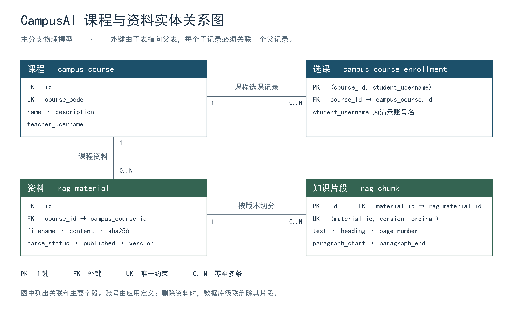

# CampusAI 数据库设计说明

洪少敏（F） · 第 1 周 · 对应主分支 `02574248ab37e38eeacaf15bf81a8990fed9d8fa`

## 已实现的物理模型

学生能否看见一条引用，分两步判断。先用选课记录确定学生是否有这门课的访问权，再由服务核对资料的课程、发布状态、解析状态及版本。外键保证课程、资料和片段的关联成立。实际可见性由后端判断。

| 表 | 字段与约束 | 业务含义 |
|---|---|---|
| `campus_course` | `id BIGINT` 主键；`course_code VARCHAR(20)` 唯一；`name VARCHAR(120)`、`description VARCHAR(400)`、`teacher_username VARCHAR(50)`。全部必填。 | 一行代表一门课程。当前每门课程记录一个教师用户名。 |
| `campus_course_enrollment` | `course_id BIGINT` 引用课程；`student_username VARCHAR(50)` 与课程 ID 共同组成主键。 | 同一名学生在同一门课只能有一条选课记录。两个学生可以选择同一门课。 |
| `rag_material` | `id VARCHAR(36)` 主键；`course_id` 为课程外键；`filename`、`content LONGBLOB`、`sha256 CHAR(64)` 保存文件信息；`parse_status`、`published`（默认假）、`version`、`parser_version` 保存状态；`error_message` 可空；`created_at`、`updated_at` 为时间字段。 | 当前原文件字节存于数据库。仓库实现更新同一份资料并递增版本；旧版下载及旧引用受版本保护。 |
| `rag_chunk` | `id VARCHAR(36)` 主键；`material_id` 引用资料并支持删除级联；`(material_id, version, ordinal)` 唯一；`text` 保存原文；`page_number`、`paragraph_start`、`paragraph_end`、`heading` 可空。 | 每个片段保留来源位置。PDF 用页码，DOCX 和 TXT 用段落范围。TXT 物理行号从 1 开始，空行占一个编号。 |

**权限与历史的设计边界。** 四个演示账号由 Java 的 `DemoAccounts` 定义，教师名和学生名目前是文本字段；数据库尚无用户表及相应用户外键。当前资料替换会更新文件并清理旧片段。后续若需长期展示问答历史，应先决定旧引用采用失效提示、证据快照，还是保留版本历史。仅保存片段 ID 无法保证旧引用始终可还原。

## 后续业务模型草案

下面是给 A、B、E 核对的逻辑设计。新实体使用业务名称，物理表名、字段类型及迁移顺序待模块负责人确认。此草案不参与第一周建库。

| 业务对象 | 建议关系与约束 | 协作人 |
|---|---|---|
| 用户、角色、选课 | 用户记录持久化；选课关联用户和课程并保留组合唯一约束。把现有四个演示用户名映射到稳定用户 ID 后，再迁移教师归属、选课记录。 | A、F |
| 章节、资料、收藏 | 一门课包含多章，资料关联本课程的一章；学生和资料通过收藏关联，限制同一用户重复收藏。发布状态沿用唯一权威字段，业务端和检索端共用。 | B、E、F |
| 问答记录、引用、反馈 | 一次问答属于一名学生和一门课；可带多条引用及用户反馈。引用记录建议保留资料 ID、版本、定位及当时所用的引文，并约定删除、下架后的查看权限。 | A、E、F |
| 题目、作答与学习记录 | 单选题、判断题归属课程或章节；作答记录关联用户、题目、提交时间与判分结果。先确定重复提交规则，再由作答记录统计正确率和错题。 | B、D、F |
| 课程访问与统计 | 约定一次有效访问的触发点、同一学生重复访问的计数方式、统计周期。用同一小组演示记录手算预期值，再与后台核对。 | B、D、F |

**交接需要确定的三件事**为用户主键如何迁移、资料由哪个模块维护发布状态、历史引用在换版后如何显示。确认后由各模块编写迁移草稿，F 核对外键、兼容性和初始化结果。

[建表 SQL](../02_初始化与样例/schema.sql) · [上游数据与检索实现](https://github.com/sjyEva/CampusAI/tree/02574248ab37e38eeacaf15bf81a8990fed9d8fa/backend/src/main/java/edu/campusai)
